# Sơ đồ hoạt động và tuần tự của Data Cleaner

Các sơ đồ mô tả luồng hiện tại từ giao diện React đến FastAPI, PostgreSQL và kho tệp trên máy chủ. Mỗi mục có một sơ đồ **activity** dạng lưu đồ và một sơ đồ **sequence** mô tả thứ tự trao đổi. Mở tài liệu trong trình đọc Markdown hỗ trợ Mermaid để xem hình.

Các API yêu cầu đăng nhập kiểm tra Bearer JWT và tải tài khoản đang hoạt động. Khi xác thực thất bại, API trả HTTP 401. Các truy vấn tệp và job dùng ID người dùng để giới hạn dữ liệu theo chủ sở hữu.

## 1. Đăng ký

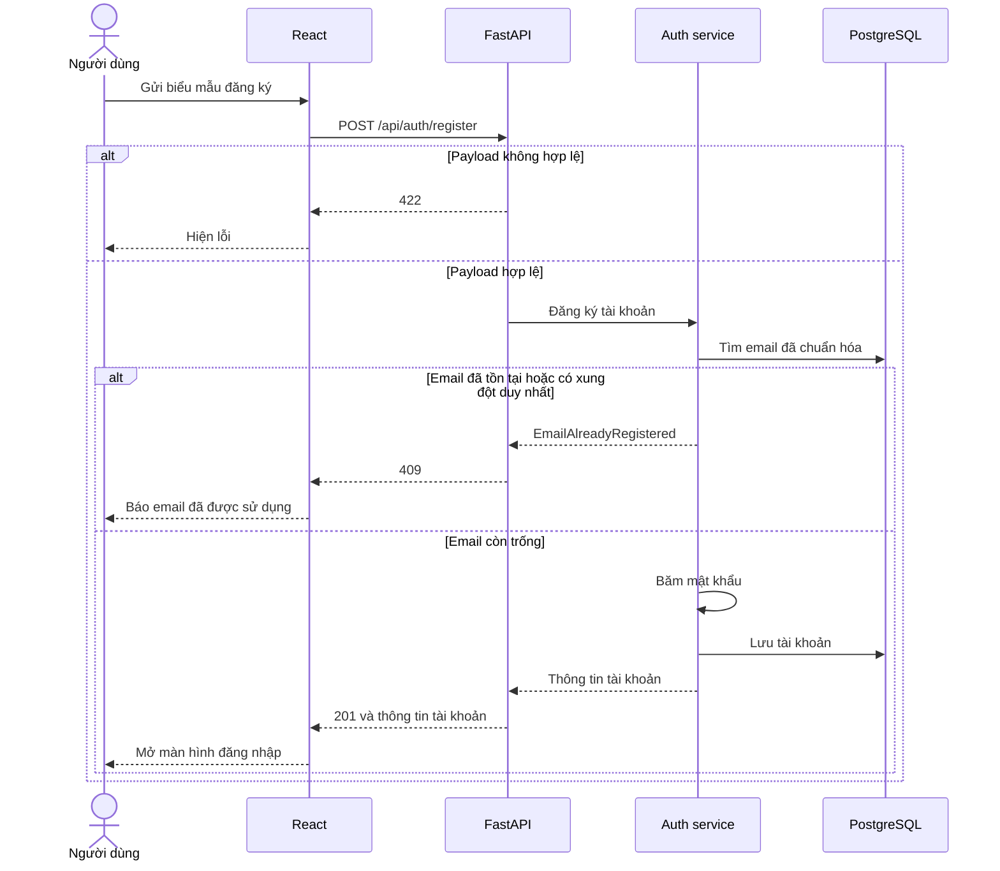

## 2. Đăng nhập, khôi phục phiên và đăng xuất

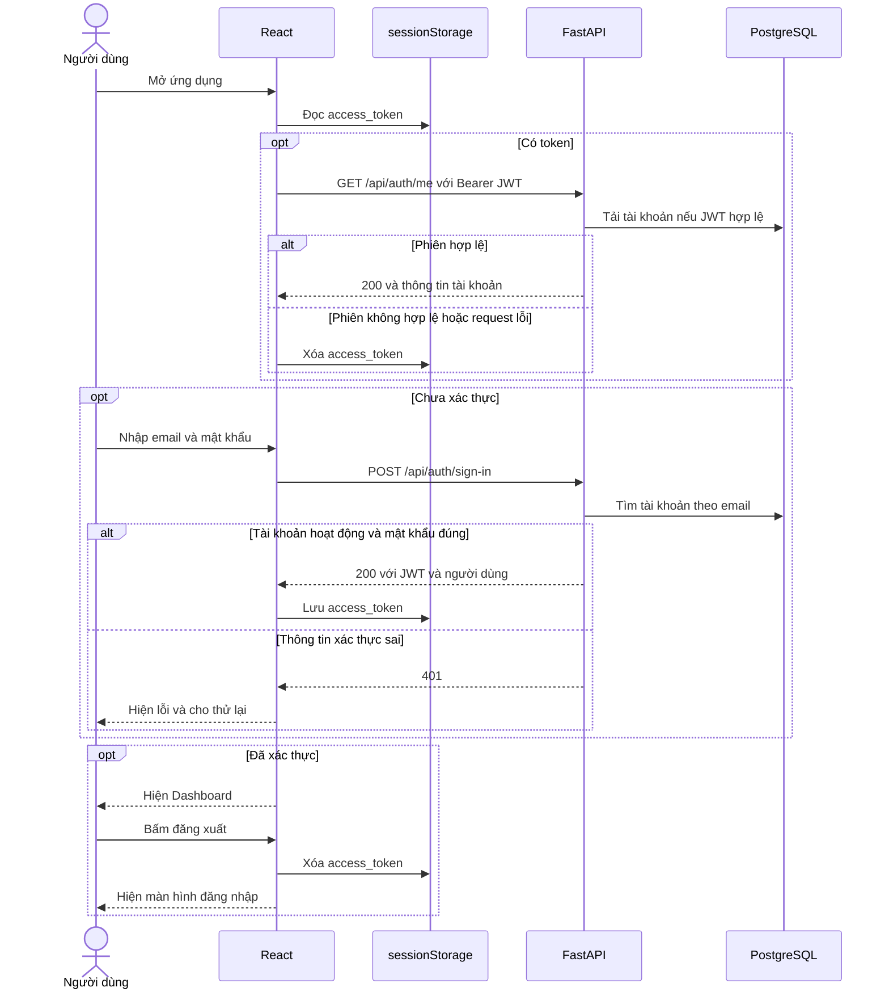

## 3. Đổi mật khẩu

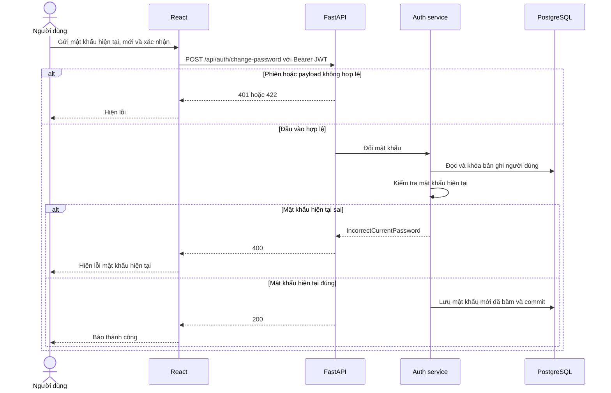

## 4. Mở Dashboard và chuyển tệp cũ

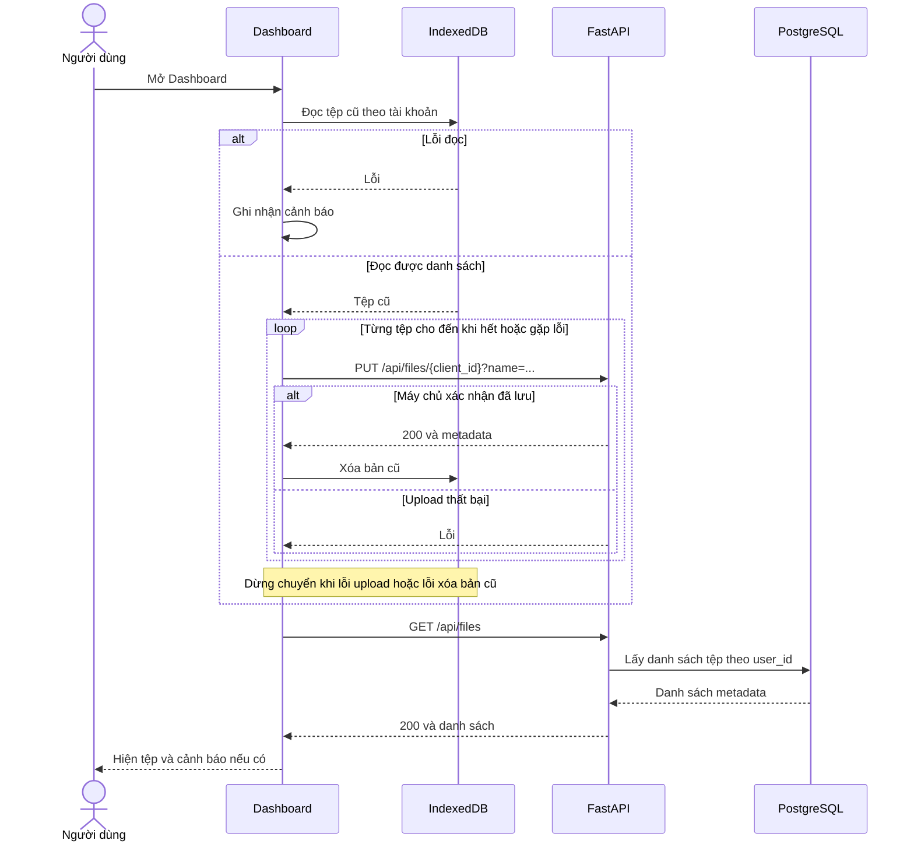

## 5. Tải tệp nguồn lên

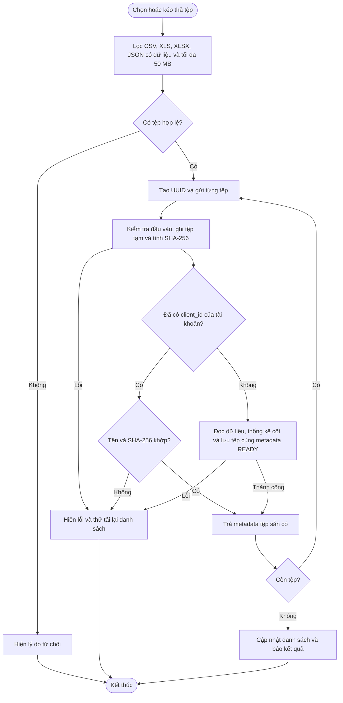

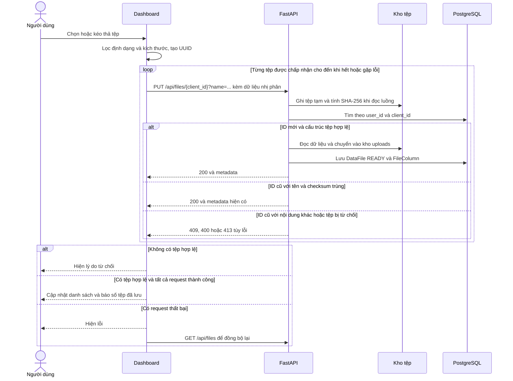

## 6. Làm sạch dữ liệu

Dashboard gửi thao tác theo thứ tự chọn, với `parameters: {}`. Mặc định hệ thống bỏ dòng có giá trị trống, khử trùng theo toàn bộ cột và chuẩn hóa khoảng trắng trong chuỗi. Tổng số dòng trên thông báo là tổng `affected_rows` qua các thao tác, nên một dòng có thể được tính ở nhiều bước.

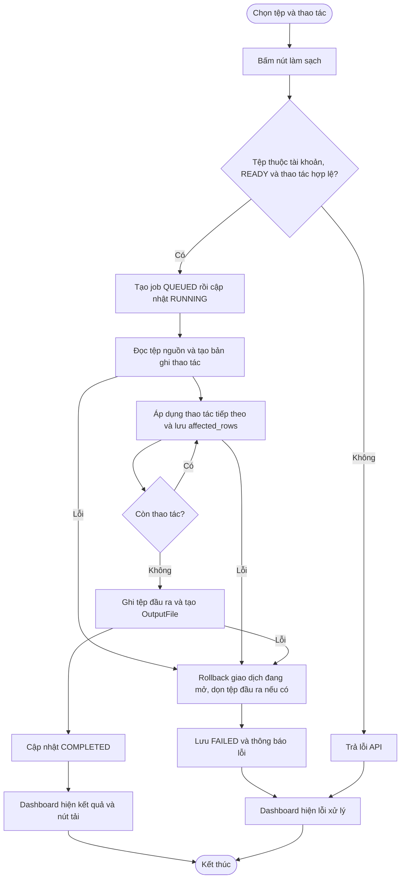

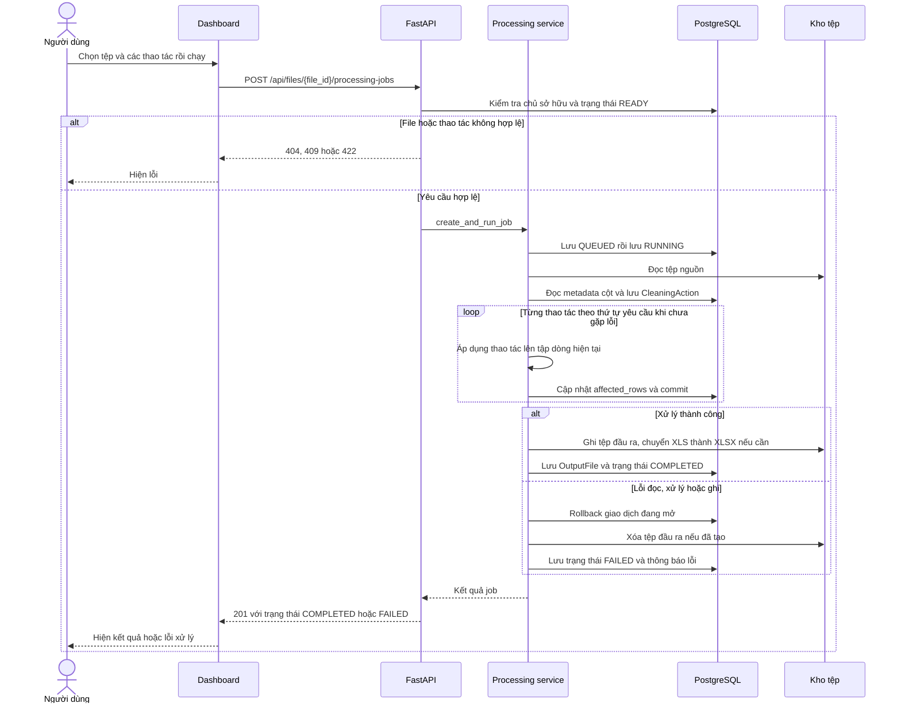

Job được xử lý đồng bộ trong request. `QUEUED` và `RUNNING` là trạng thái được ghi vào cơ sở dữ liệu trong cùng luồng xử lý.

## 7. Tải tệp kết quả

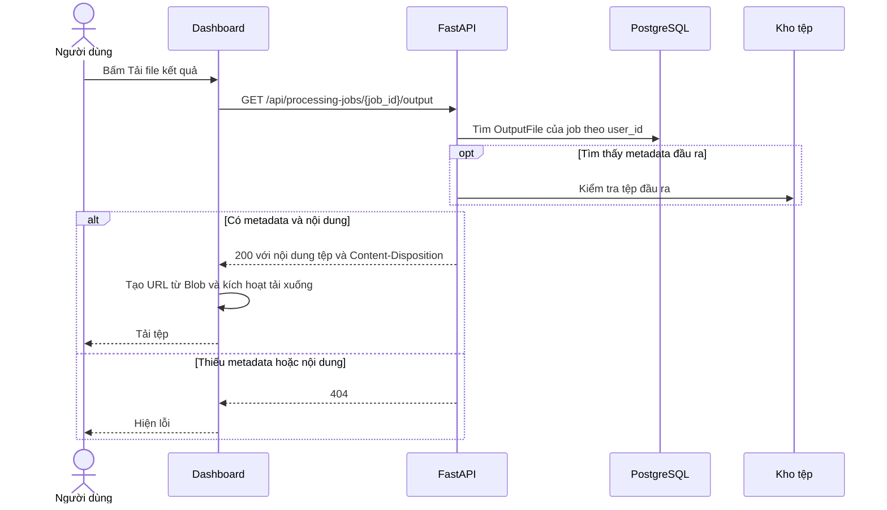

## 8. Xóa tệp

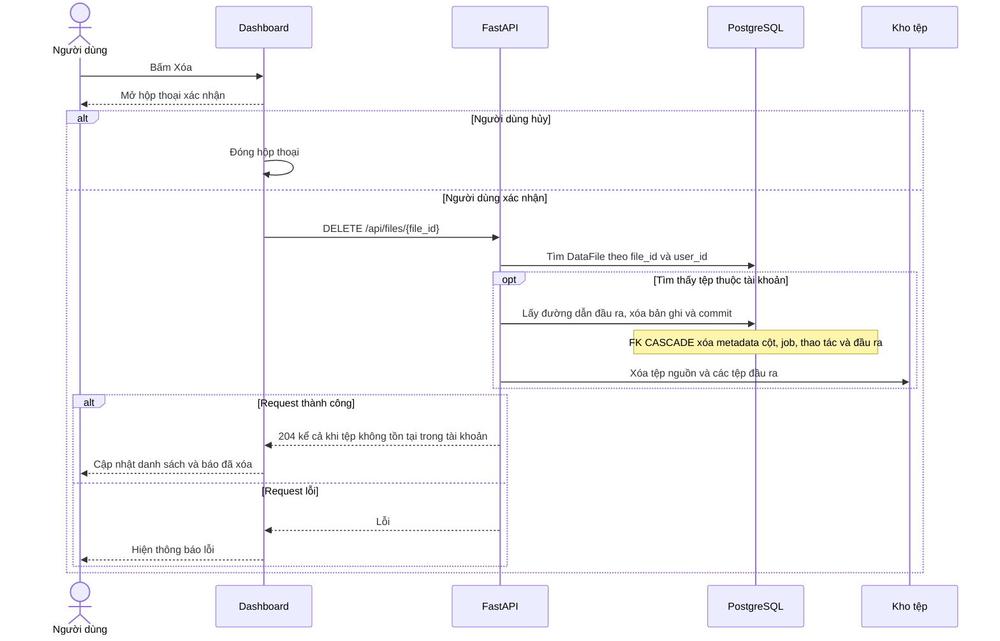

## 9. Tra cứu tệp và lịch sử xử lý qua API

Các endpoint này có trong backend. Dashboard hiện tại dùng danh sách tệp, tạo job và tải kết quả trực tiếp từ job vừa chạy. Các truy vấn dưới đây mô tả thêm những thao tác có thể thực hiện qua API.

| Truy vấn | Endpoint |
| --- | --- |
| Metadata cột theo thứ tự | `GET /api/files/{file_id}/columns` |
| Nội dung tệp nguồn | `GET /api/files/{file_id}/content` |
| Lịch sử job của tệp, mới nhất trước | `GET /api/files/{file_id}/processing-jobs` |
| Chi tiết job, các thao tác và đầu ra nếu có | `GET /api/processing-jobs/{job_id}` |

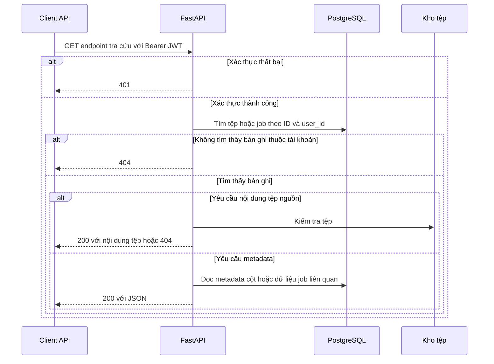

## Mã nguồn đối chiếu

- [React App và phiên đăng nhập](../frontend/src/App.jsx)
- [Giao diện tài khoản](../frontend/src/modules/authentication)
- [Dashboard](../frontend/src/pages/dashboard/Dashboard.jsx)
- [Frontend client cho tệp và job](../frontend/src/modules/dashboard/data/serverFileStorage.js)
- [API và dịch vụ xác thực](../backend/app/api/routes/auth.py), [middleware](../backend/app/api/middlewares/authentication.py), [dịch vụ](../backend/app/modules/authentication/service.py)
- [API tệp](../backend/app/api/routes/files.py), [API job](../backend/app/api/routes/processing.py), [dịch vụ xử lý](../backend/app/modules/processing/service.py)
