# Sơ đồ Activity của Data Cleaner

Cập nhật ngày 26/11/2026. Các sơ đồ mô tả các bước, điểm ra quyết định và nhánh xử lý từ trang khách đến quản lý tệp, làm sạch, phân tích và vận hành.

Các API yêu cầu đăng nhập kiểm tra Bearer JWT và giới hạn truy vấn tệp, job theo chủ sở hữu. Khi xác thực thất bại, API trả HTTP 401.

## Cách xem sơ đồ

Mở tài liệu trong trình đọc Markdown hỗ trợ Mermaid hoặc mở draw.io và chọn **Arrange → Insert → Mermaid**. Sao chép một khối, bắt đầu từ dòng `flowchart TD`, bỏ hai dòng dấu rào Markdown rồi bấm **Insert**.

Đọc theo chiều mũi tên. Hình thoi là điểm ra quyết định và nhãn trên mũi tên cho biết điều kiện chuyển bước.

Xem thêm [đặc tả Use Case](Use-case-Data-Cleaner.md) và [sơ đồ Sequence](So-do-sequence.md).

## Tổng quan luồng sử dụng

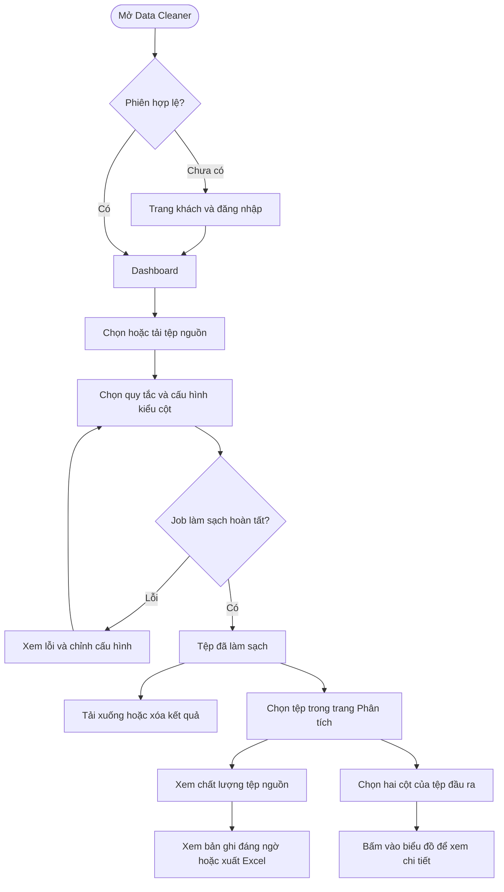

## 0. Trang khách và yêu cầu đăng nhập

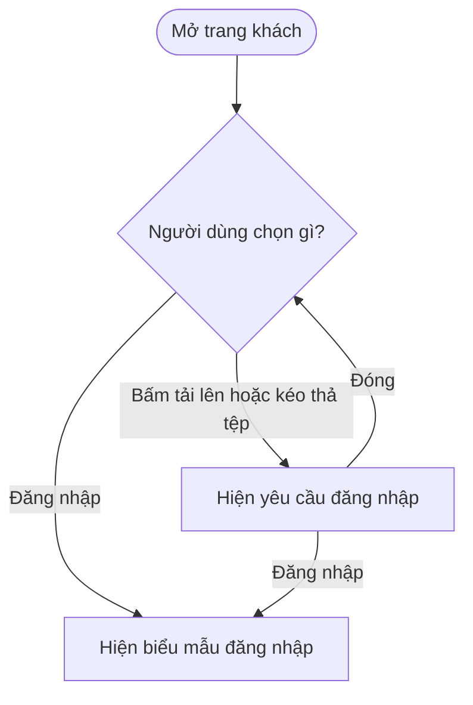

## 1. Đăng ký

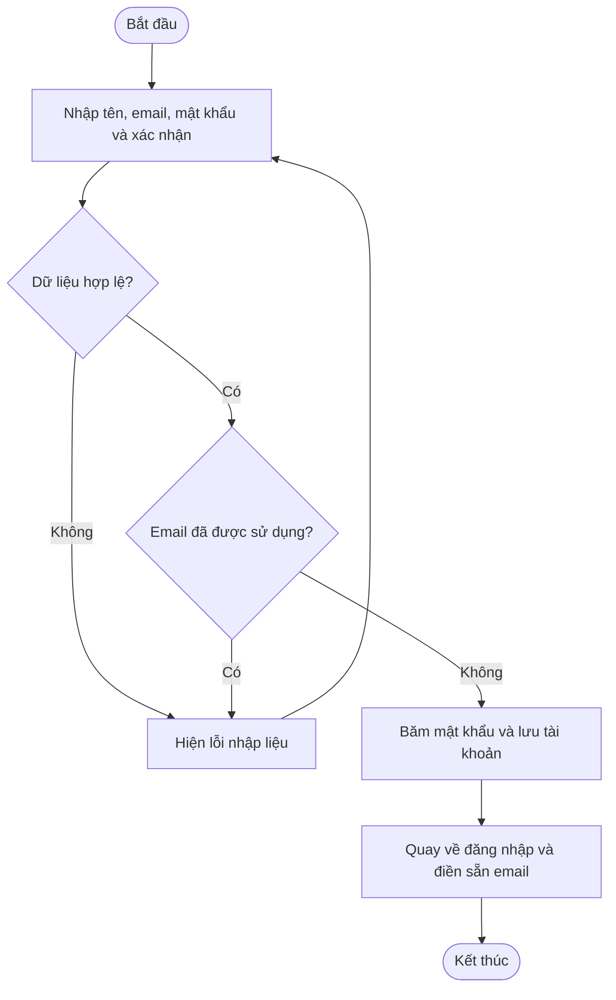

## 2. Đăng nhập, khôi phục phiên và đăng xuất

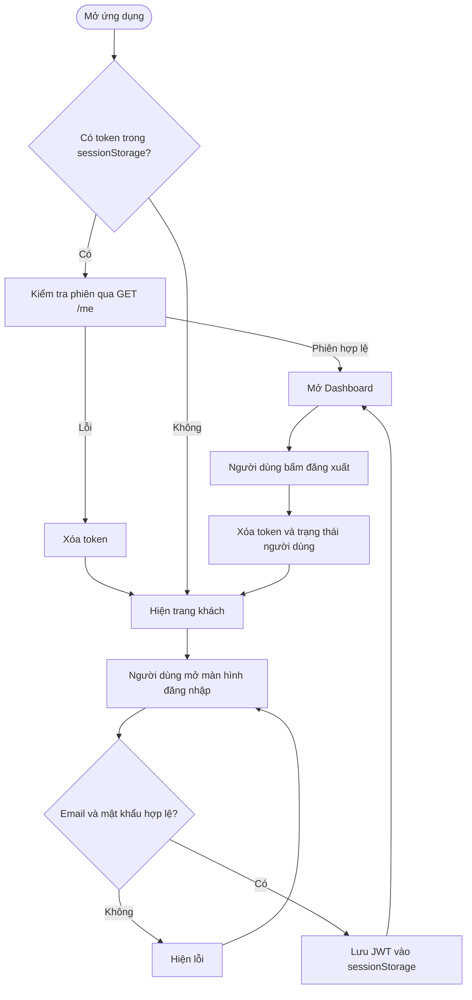

## 3. Đổi mật khẩu

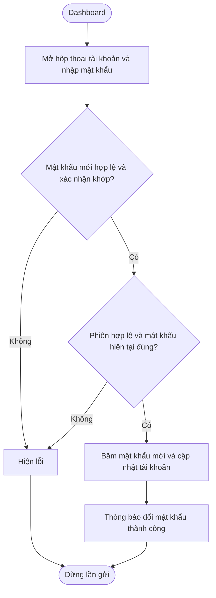

## 4. Mở Dashboard và chuyển tệp cũ

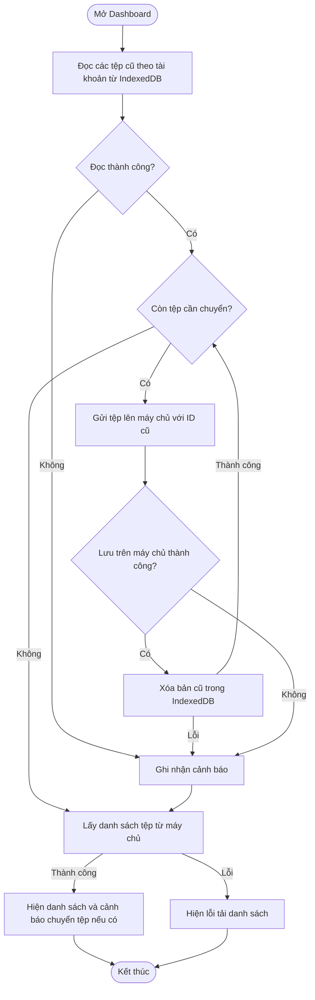

## 5. Tải tệp nguồn lên

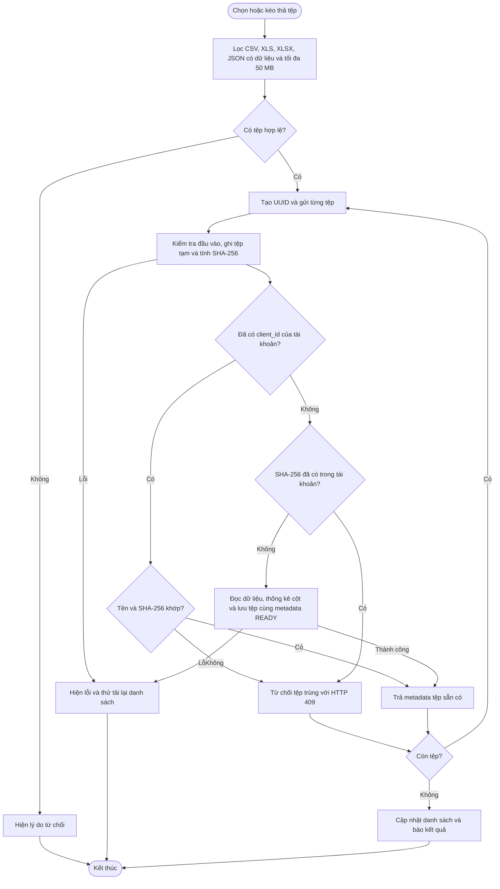

## 6. Cấu hình và chạy làm sạch dữ liệu

Kiểm tra kiểu đọc dữ liệu nguồn để giữ số dòng gốc. Các thao tác biến đổi dữ liệu chạy theo thứ tự gửi lên. Job xử lý đồng bộ trong request. Giao diện chờ tối thiểu 15 giây nếu người dùng tiếp tục chờ.

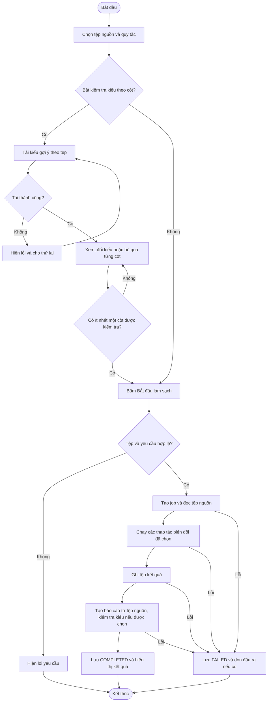

Bấm Hủy đưa người dùng về trang làm sạch ngay. Request có thể tiếp tục chạy. Giao diện thử dọn job sau khi nhận được phản hồi có ID.

## 7. Tải tệp kết quả

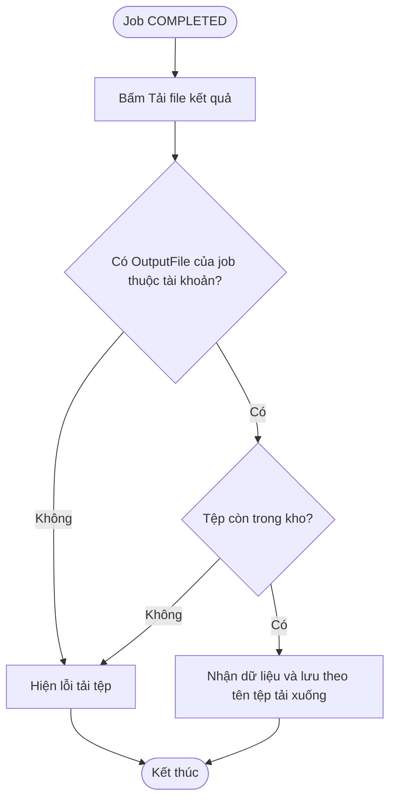

## 8. Xóa tệp

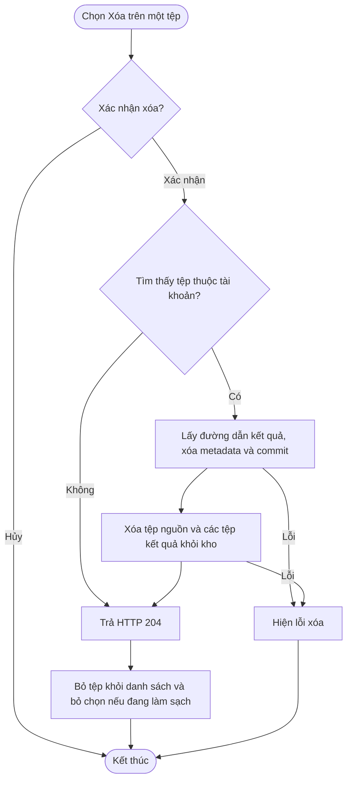

## 9. Tra cứu tệp và lịch sử xử lý qua API

Các endpoint này có trong backend. Dashboard hiện tại dùng danh sách tệp, tạo job và tải kết quả trực tiếp từ job vừa chạy. Các truy vấn dưới đây mô tả thêm những thao tác có thể thực hiện qua API.

| Truy vấn | Endpoint |
| --- | --- |
| Metadata cột theo thứ tự | `GET /api/files/{file_id}/columns` |
| Nội dung tệp nguồn | `GET /api/files/{file_id}/content` |
| Lịch sử job của tệp, mới nhất trước | `GET /api/files/{file_id}/processing-jobs` |
| Chi tiết job, các thao tác và đầu ra nếu có | `GET /api/processing-jobs/{job_id}` |

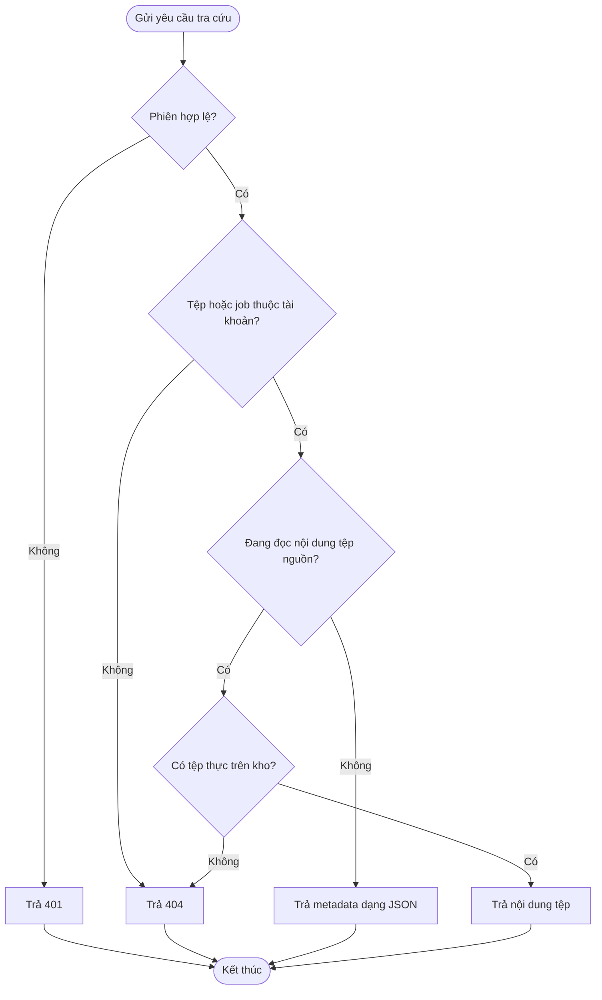

## 10. Xem danh sách và xóa riêng tệp kết quả

Activity mô tả ba lựa chọn sau khi đã mở danh sách, gồm tải xuống, mở báo cáo và xóa. Sequence tập trung vào tải danh sách và xác nhận xóa. Nếu đầu ra đã vắng mặt trong phạm vi tài khoản, lệnh xóa vẫn trả `204`. Tệp nguồn và job tiếp tục tồn tại.

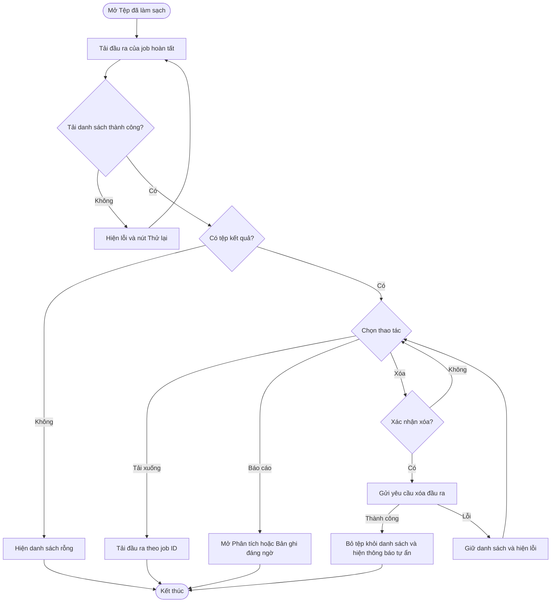

## 11. Xem chất lượng dữ liệu và tải bản ghi đáng ngờ

Trang Phân tích hiển thị báo cáo tổng hợp ngay dưới bộ chọn tệp ở cột trái. Mục Bản ghi đáng ngờ hiển thị các phát hiện chi tiết theo trang. Tệp Excel chứa toàn bộ phát hiện chi tiết của job. Danh sách, tổng số và tệp Excel đều bỏ các mục chỉ liên quan đến khoảng trắng. Báo cáo dùng dữ liệu nguồn trước khi làm sạch.

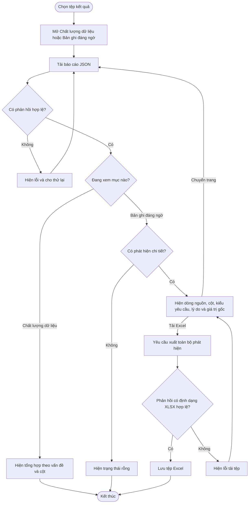

## 12. Kiểm tra trạng thái API

Health check xác nhận FastAPI phản hồi. Kết quả này kiểm tra endpoint sức khỏe của ứng dụng.

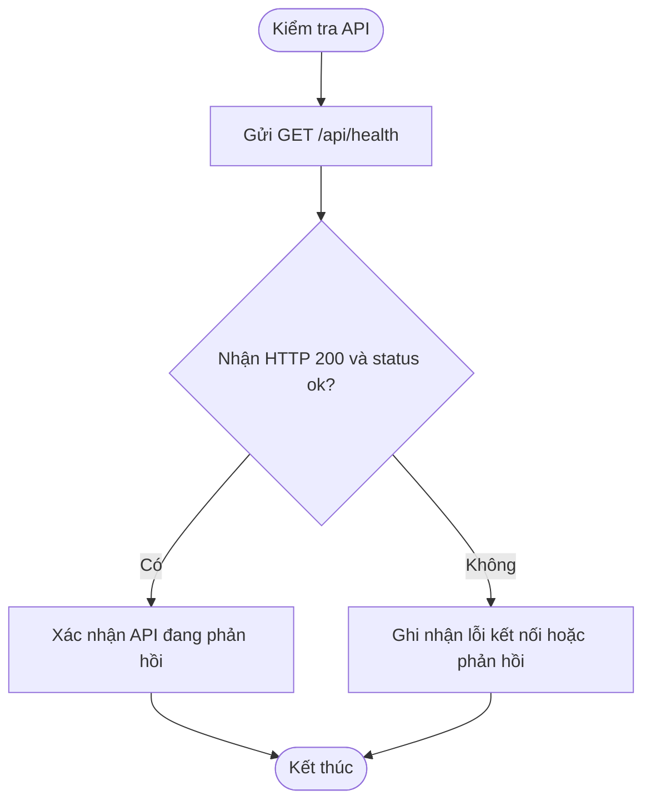

## 13. Khám phá hai cột và xem chi tiết biểu đồ

Biểu đồ sử dụng tệp đã làm sạch. Mỗi lượt so sánh xét các dòng có đủ giá trị ở cả hai cột. Khi xem theo giờ, một bản ghi trong khung 17:00–18:00 được đếm theo giờ ghi trong tệp, cộng dồn qua các ngày. Chế độ đếm mã khác nhau tính mỗi giá trị một lần trong từng khung giờ.

```mermaid
flowchart TD
    start([Mở trang Phân tích]) --> choose["Chọn tệp đã làm sạch"]
    choose --> cols["Tải thống kê và danh sách cột"]
    cols --> enough{"Có ít nhất hai cột?"}
    enough -->|Không| empty["Hiện thông báo và chờ chọn tệp khác"]
    empty --> choose
    enough -->|Có| select["Chọn hai cột khác nhau"]
    select --> load["Yêu cầu so sánh hai cột"]
    load --> outcome{"Kết quả yêu cầu"}
    outcome -->|Lỗi| retry["Hiện lỗi và cho thử lại"]
    retry --> load
    outcome -->|Không có cặp giá trị đầy đủ| noData["Hiện thông báo thiếu dữ liệu"]
    noData --> select
    outcome -->|Có dữ liệu| type{"Chọn dạng biểu đồ"}
    type -->|Ngày giờ| hourly["Vẽ biểu đồ theo giờ"]
    type -->|Mã nhận diện| unique["Đếm mã khác nhau theo nhóm"]
    type -->|Hai cột số đo| scatter["Vẽ biểu đồ phân tán"]
    type -->|Số đo và nhóm| average["Vẽ trung bình theo nhóm"]
    type -->|Các cặp còn lại| pairs["Đếm dòng theo cặp giá trị"]
    hourly -->|Đổi cách tính hoặc bộ lọc| hourly
    hourly --> click["Bấm thanh, cột giờ hoặc điểm"]
    unique --> click
    scatter --> click
    average --> click
    pairs --> click
    click --> detail["Hiện số liệu và câu giải thích ở khung chi tiết"]
    detail -->|Đổi cặp cột| select
```

## 14. Khởi động backend và chuyển dữ liệu lưu trữ cũ

FastAPI chạy bước chuẩn bị kho tệp và cơ sở dữ liệu khi khởi động. Bước chuyển sang kho tệp áp dụng cho bảng PostgreSQL `uploaded_files` cũ. Mục 4 mô tả luồng chuyển tệp đã lưu trong trình duyệt.

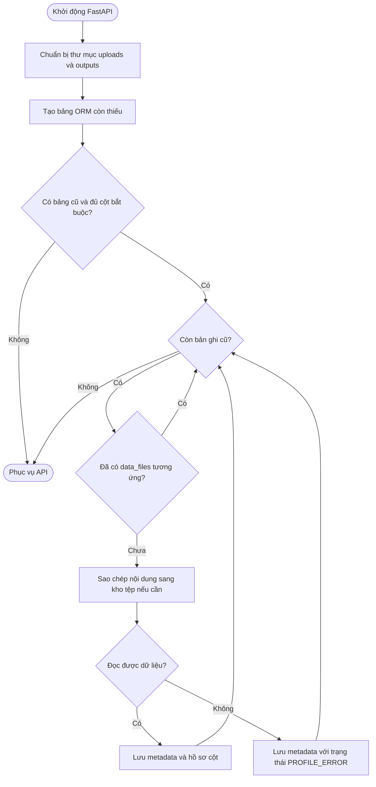

## Mã nguồn đối chiếu

- [React App và phiên đăng nhập](../../frontend/src/App.jsx)
- [Giao diện tài khoản](../../frontend/src/modules/authentication)
- [Dashboard](../../frontend/src/pages/dashboard/Dashboard.jsx)
- [Frontend client cho tệp và job](../../frontend/src/modules/dashboard/data/serverFileStorage.js)
- [API xác thực](../../backend/app/api/routes/auth.py), [middleware](../../backend/app/api/middlewares/authentication.py), [dịch vụ xác thực](../../backend/app/modules/authentication/service.py)
- [API tệp](../../backend/app/api/routes/files.py), [API job](../../backend/app/api/routes/processing.py), [dịch vụ xử lý](../../backend/app/modules/processing/service.py)
- [API phân tích](../../backend/app/api/routes/analysis.py), [quy tắc báo cáo](../../backend/app/modules/processing/quality.py)
- [Trang khách](../../frontend/src/pages/guest-home/GuestHome.jsx), [trang Phân tích](../../frontend/src/pages/analysis/Analysis.jsx), [biểu đồ hai cột](../../frontend/src/pages/analysis/ColumnStatistics.jsx)
- [Tính thống kê và so sánh](../../backend/app/modules/processing/statistics.py), [model thống kê](../../backend/app/models/analysis_result.py)
- [Vòng đời FastAPI](../../backend/app/main.py), [chuyển dữ liệu cũ](../../backend/app/db/migrations.py)
