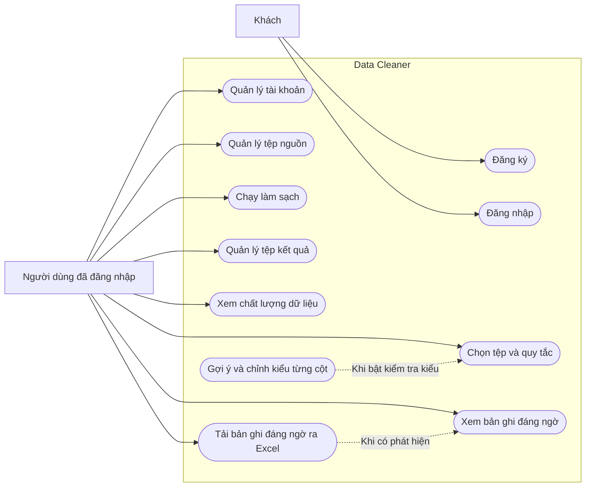

# Đặc tả use case của Data Cleaner

Cập nhật ngày 22/11/2026. Tài liệu mô tả hành vi hiện có của giao diện React và API FastAPI. Các mã sơ đồ tham chiếu đến [sơ đồ activity và sequence](So-do-activity-va-sequence.md).

## Tác nhân và điều kiện chung

- **Khách** có thể đăng ký và đăng nhập.
- **Người dùng đã đăng nhập** có thể quản lý tài khoản, tệp nguồn, job và tệp kết quả của mình.
- **Ứng dụng gọi API** có thể sử dụng các endpoint tra cứu, truyền JWT qua header `Authorization: Bearer <token>` khi endpoint yêu cầu xác thực.
- Yêu cầu thiếu JWT hợp lệ nhận HTTP `401`. Tệp và job được tra cứu trong phạm vi tài khoản. PostgreSQL lưu metadata, job và kết quả kiểm tra. Kho tệp lưu nội dung nguồn và đầu ra.

## Sơ đồ use case tổng quan

## Tài khoản và phiên

| Mã | Chức năng và điều kiện | Luồng chính và kết quả | Ngoại lệ | Sơ đồ |
| --- | --- | --- | --- | --- |
| UC-01 | **Đăng ký**. Khách mở biểu mẫu. | Nhập họ tên, email, mật khẩu và xác nhận. API kiểm tra dữ liệu, băm mật khẩu, lưu tài khoản rồi trả `201`. Giao diện chuyển đến đăng nhập và điền email. | Email đã dùng `409`. Trường sai định dạng hoặc xác nhận không khớp `422`. | 1 |
| UC-02 | **Đăng nhập**. Khách có tài khoản hoạt động. | Gửi email và mật khẩu. API trả JWT và thông tin tài khoản. Giao diện lưu token trong `sessionStorage` và mở Dashboard. | Sai thông tin hoặc tài khoản không hoạt động `401`. Payload sai `422`. | 2 |
| UC-03 | **Khôi phục phiên**. Trình duyệt có token. | Khi mở ứng dụng, gọi `GET /api/auth/me`. Phiên hợp lệ mở Dashboard. | Nếu không xác minh được phiên, giao diện xóa token và hiển thị đăng nhập. | 2 |
| UC-04 | **Đăng xuất**. Người dùng đã vào Dashboard. | Bấm đăng xuất. Giao diện xóa token khỏi `sessionStorage` và trở về đăng nhập. | Cần đăng nhập lại để mở tài nguyên bảo vệ. | 2 |
| UC-05 | **Xem tài khoản và đổi mật khẩu**. Phiên hợp lệ. | Mở hộp thoại tài khoản. Nhập mật khẩu hiện tại, mật khẩu mới và xác nhận. API kiểm tra mật khẩu hiện tại và lưu bản băm mới. | Mật khẩu hiện tại sai `400`. Mật khẩu mới dưới 12 hoặc trên 128 ký tự, trùng mật khẩu hiện tại hoặc xác nhận sai `422`. | 3 |

## Tệp nguồn

| Mã | Chức năng và điều kiện | Luồng chính và kết quả | Ngoại lệ | Sơ đồ |
| --- | --- | --- | --- | --- |
| UC-06 | **Xem bộ dữ liệu**. Đã đăng nhập. | Dashboard gọi `GET /api/files` và hiện tên, kích cỡ, thời điểm lưu. Nếu có tệp cũ trong trình duyệt, ứng dụng thử chuyển lên bằng mã cũ. | Khi chuyển tệp thất bại, dữ liệu cục bộ tương ứng được giữ để thử lại. | 4 |
| UC-07 | **Tải tệp nguồn**. Chọn tệp hoặc kéo thả. | FE lọc tệp rỗng, sai định dạng hoặc vượt 50 MiB. Với mỗi tệp hợp lệ, tạo UUID, gửi raw body, API tính SHA-256, đọc dữ liệu và lưu hồ sơ cột. | Cùng SHA-256 trong cùng tài khoản nhận `409` và “Tệp đã tồn tại.”, kể cả đã đổi tên. FE tiếp tục với các tệp khác khi gặp `409`. Tệp không đọc được `400`, vượt dung lượng `413`. | 5 |
| UC-08 | **Xóa tệp nguồn**. Có tệp trong danh sách. | Bấm Xóa và xác nhận. API xóa tệp nguồn, metadata và các job cùng kết quả liên quan; FE cập nhật danh sách. | Bấm Hủy để đóng hộp thoại. Yêu cầu lặp lại khi tệp đã vắng mặt trả `204`. | 8 |
| UC-09 | **Đọc hồ sơ cột hoặc tải tệp nguồn qua API**. Có `file_id`. | `GET /api/files/{file_id}/columns` trả kiểu suy luận, số giá trị thiếu và số giá trị phân biệt; `GET /api/files/{file_id}/content` trả nội dung gốc. | Tệp ngoài phạm vi tài khoản hoặc nội dung nguồn không tồn tại nhận `404` theo endpoint. | 9 |

**Quy tắc tải lên.** Nhận CSV, XLS, XLSX và JSON. Nếu gửi lại cùng `client_id`, cùng tên và cùng SHA-256, API trả metadata đã lưu. Nếu dùng lại mã đó với tên hoặc nội dung khác, API trả `409`.

## Làm sạch và quản lý kết quả

| Mã | Chức năng và điều kiện | Luồng chính và kết quả | Ngoại lệ | Sơ đồ |
| --- | --- | --- | --- | --- |
| UC-10 | **Chọn tệp và quy tắc**. Có tệp nguồn. | Bấm Làm sạch cạnh tệp, chọn từng quy tắc hoặc Chọn tất cả. Nếu bật kiểm tra kiểu, ứng dụng gợi ý kiểu theo tệp. Người dùng có thể tìm cột, đổi kiểu hoặc bỏ qua cột. Chọn tất cả tự mở cấu hình khi đã có tệp. | Nếu chưa chọn đủ tệp và ít nhất một quy tắc, giao diện yêu cầu chọn tệp hoặc quy tắc. Khi bật kiểm tra kiểu, cần chọn kiểu cho ít nhất một cột. | 6 |
| UC-11 | **Chạy làm sạch**. Tệp thuộc tài khoản, ở trạng thái `READY`. | API tạo job, đọc nguồn, áp dụng lần lượt các thao tác biến đổi đã gửi, ghi số dòng bị tác động và tạo tệp kết quả. Nếu có cấu hình kiểu, kiểm tra từng ô của tệp nguồn và ghi phát hiện sai kiểu. Tệp nguồn XLS cho đầu ra XLSX. | Yêu cầu không hợp lệ nhận `404`, `409` hoặc `422`. Lỗi trong lúc chạy được ghi vào job `FAILED`, có thể nằm trong phản hồi `201`. | 6 |
| UC-12 | **Hủy chờ làm sạch**. FE đang chờ kết quả. | Bấm Hủy để quay lại trang làm sạch. Khi nhận được phản hồi job, FE thử gọi `DELETE /api/processing-jobs/{job_id}` để dọn job và đầu ra. | Backend có thể tiếp tục xử lý request đã nhận. FE báo nếu không dọn được kết quả đã hủy. | 6 |
| UC-13 | **Xem lịch sử hoặc trạng thái job qua API**. Có ID tệp hoặc job. | `GET /api/files/{file_id}/processing-jobs` trả lịch sử. `GET /api/processing-jobs/{job_id}` trả trạng thái, thời gian, thao tác và đầu ra nếu có. | Tài nguyên ngoài phạm vi tài khoản nhận `404`. | 9 |
| UC-14 | **Xem danh sách tệp đã làm sạch**. Đã đăng nhập. | `GET /api/cleaned-files` liệt kê đầu ra từ job hoàn tất. FE hiển thị tên kết quả, tệp gốc, định dạng và thời điểm hoàn tất. | Danh sách rỗng có thông báo riêng. Lỗi tải danh sách có nút thử lại. | 10 |
| UC-15 | **Tải tệp kết quả**. Job có đầu ra. | Bấm Tải xuống tại kết quả của job hoặc danh sách. FE gọi `GET /api/processing-jobs/{job_id}/output` và lưu tệp theo tên trả về. | Thiếu metadata đầu ra hoặc thiếu nội dung kho tệp nhận `404`. | 7 |
| UC-16 | **Xóa riêng tệp kết quả**. Có tệp đã làm sạch. | Bấm Xóa và xác nhận. API xóa đầu ra, còn tệp nguồn và lịch sử job vẫn tồn tại. FE bỏ tệp khỏi danh sách và hiện thông báo tự ẩn sau 2 giây. | Khi đầu ra đã vắng mặt trong phạm vi tài khoản, API trả `204`. Nếu xóa thất bại, giao diện báo lỗi. | 10 |

### Quy tắc làm sạch đang có

| Quy tắc | Mặc định từ giao diện | Tùy chọn qua API |
| --- | --- | --- |
| `missing_values` | Bỏ dòng có ít nhất một giá trị null hoặc chuỗi chỉ có khoảng trắng. | `strategy: fill_value` và `value` để thay giá trị thiếu. |
| `remove_duplicates` | So toàn bộ cột và giữ lần xuất hiện đầu tiên. | `columns` để chọn cột dùng so trùng. |
| `validate_types` | Kiểm tra các cột đã chọn theo kiểu yêu cầu và ghi nhận các ô sai kiểu. | `column_types` ánh xạ tên cột sang VARCHAR, INTEGER, DECIMAL, DATE hoặc BOOLEAN. |
| `normalize_format` | Cắt khoảng trắng đầu/cuối và thu gọn cụm ký tự trắng trong chuỗi. | `case: lower`, `upper` hoặc mặc định `preserve`. |

## Phân tích và bản ghi đáng ngờ

| Mã | Chức năng và điều kiện | Luồng chính và kết quả | Ngoại lệ | Sơ đồ |
| --- | --- | --- | --- | --- |
| UC-17 | **Xem chất lượng dữ liệu**. Có tệp kết quả. | Chọn tệp ở Phân tích hoặc bấm Chất lượng dữ liệu từ danh sách tệp. API trả các vấn đề trên dữ liệu nguồn trước khi làm sạch. FE hiển thị loại vấn đề, phạm vi, số lượng và tỷ lệ. | Không có vấn đề thì hiện trạng thái rỗng. Báo cáo cũ được tạo khi mở lần đầu nếu đọc được tệp nguồn. Thiếu tệp kết quả `404`, không đọc được nguồn để tạo báo cáo cũ `409`. | 11 |
| UC-18 | **Xem bản ghi đáng ngờ**. Có tệp kết quả. | Bấm nút tương ứng để mở vùng riêng dưới danh sách. Xem tổng phát hiện, số bản ghi nguồn, cột hoặc toàn dòng, loại vấn đề, lý do và giá trị gốc. Lỗi sai kiểu có kiểu yêu cầu và lý do cụ thể. Có thể mở rộng giá trị dài và chuyển trang. | Nếu không có phát hiện, FE hiển thị trạng thái rỗng. Có nút thử lại khi tải thất bại. | 11 |
| UC-20 | **Tải bản ghi đáng ngờ ra Excel**. Báo cáo có phát hiện. | Bấm Tải bản ghi đáng ngờ (Excel). API trả toàn bộ mục theo tệp kết quả, không áp dụng phân trang. FE kiểm tra định dạng trước khi lưu tệp .xlsx. | Nút tải bị vô hiệu khi danh sách rỗng. Nếu phản hồi lỗi hoặc sai định dạng, giao diện báo lỗi. | 11 |

Báo cáo mô tả dữ liệu nguồn trước khi làm sạch. Bảng tổng hợp ghi nhận giá trị thiếu, dòng trùng, khoảng trắng theo cấu hình và ô sai kiểu khi có quy tắc kiểm tra. Danh sách chi tiết gồm dòng trùng toàn bộ và ô sai kiểu. Một dòng có thể sinh nhiều phát hiện. Số thứ tự bắt đầu từ 1 và bỏ qua tiêu đề.

API báo cáo là `GET /api/analysis/cleaned-files/{job_id}/quality`. JSON mặc định dùng `offset=0`, `limit=25` và giới hạn 100 mục mỗi trang. Tham số `format=xlsx` xuất toàn bộ phát hiện chi tiết.

## Kiểm tra vận hành và mục giao diện

- **UC-19 · Kiểm tra API**. `GET /api/health` trả `200` và `{"status":"ok"}` để xác nhận ứng dụng đang phản hồi.
- **Thông báo**. Nút chuông hiện thông báo rằng chưa có thông báo mới. **Hoạt động** hiện là mục điều hướng, chưa có trang lịch sử riêng. Lịch sử job hiện được tra cứu bằng API ở UC-13.

Nguồn đối chiếu gồm [API hiện tại](../../api-docs/README.md), [route backend](../../backend/app/api/routes) và [các trang frontend](../../frontend/src/pages).
